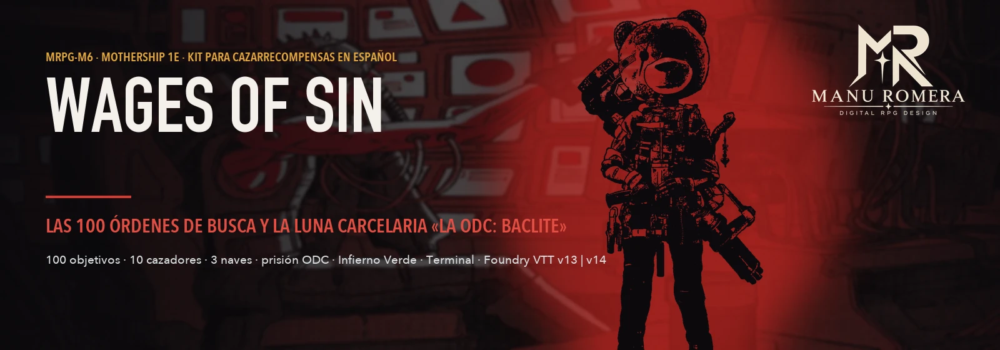
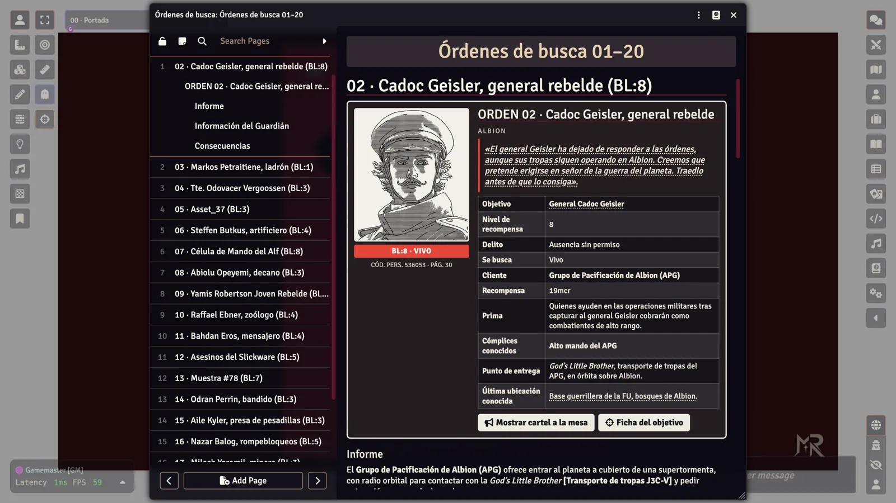
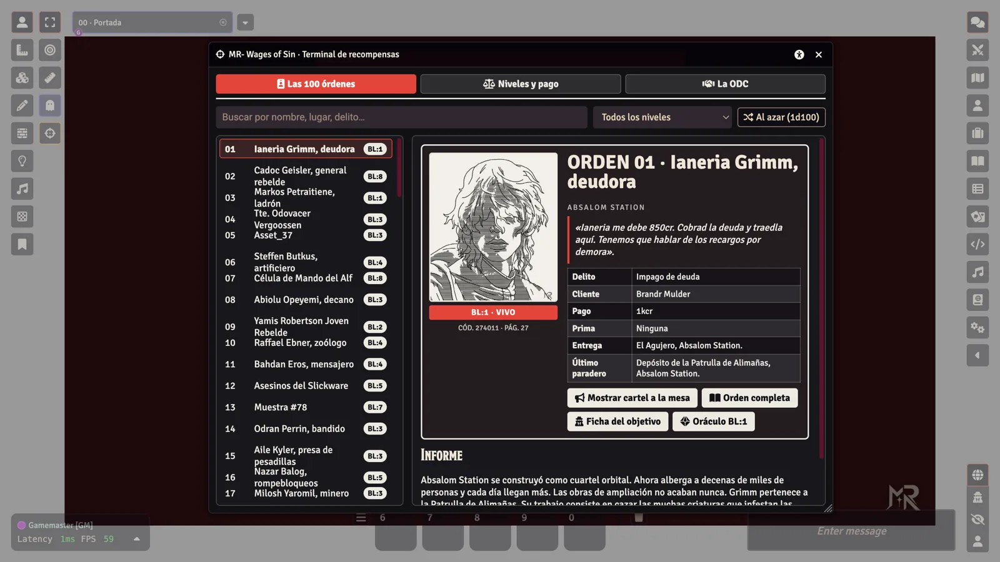
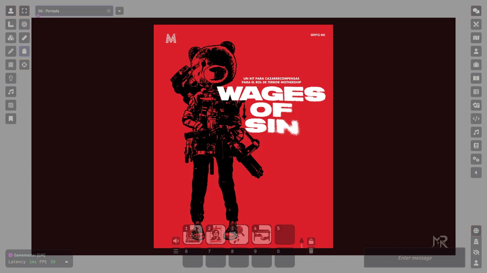
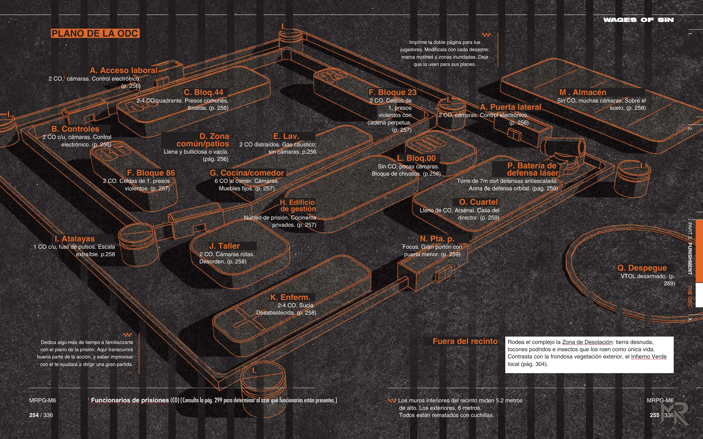
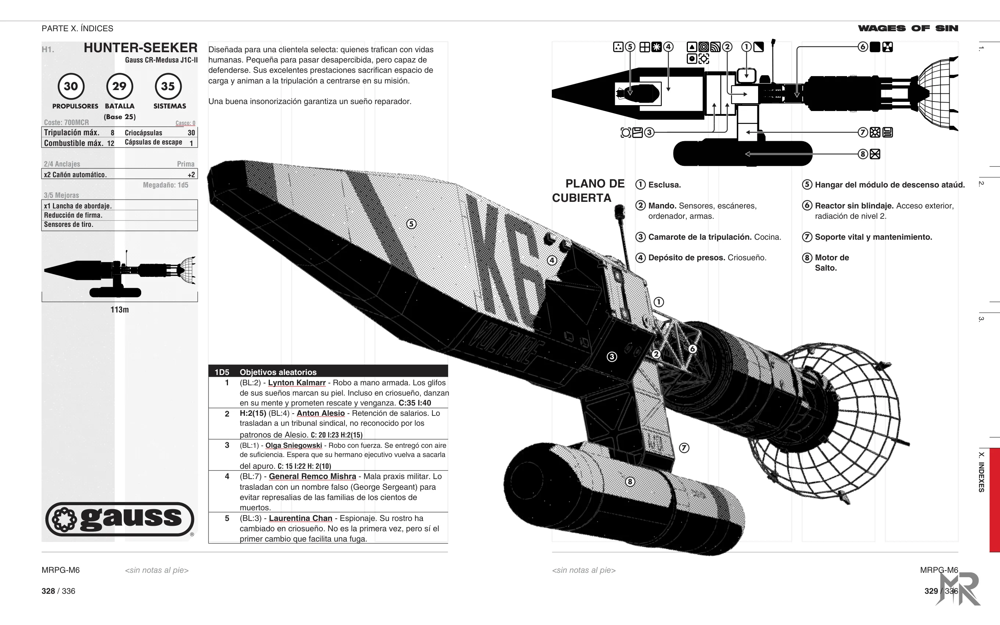

<p align="center">
  
</p>

<p align="center">
  <a href="https://github.com/ManuRomera"></a>
  <a href="https://github.com/ManuRomera/mr-wages-of-sin/releases/latest"></a>
  
  <a href="https://github.com/ManuRomera/mr-wages-of-sin/releases"></a>
  
  
  <a href="LICENSE"></a>
</p>

<h3 align="center">El libro de <strong>Wages of Sin</strong> en español para Foundry VTT: las 100 órdenes de busca con su retrato, los 10 cazarrecompensas rivales, la prisión <em>«La ODC: Baclite»</em> y las 3 naves. Se instala solo y deja cada cosa en su carpeta.</h3>

> [!IMPORTANT]
> Este módulo está diseñado para el sistema [**MoSh – Unofficial Mothership**](https://foundryvtt.com/packages/mosh) (`0.6.1+`) y se integra de forma nativa con [**MR- Mothership en español**](https://github.com/ManuRomera/mr-mothership-es) (traducción, modo oscuro y accesibilidad compartidos), [**MR- Kit del Desguazador**](https://github.com/ManuRomera/mr-kit-desguazador) (ficha de nave y combate naval para las 3 naves incluidas) y [**MR- Dirección**](https://github.com/ManuRomera/mr-direccion) (lecturas, relojes y figuras de cuerpo entero a escala).

<p align="center">
  <a href="https://github.com/ManuRomera/mr-wages-of-sin/releases/latest/download/module.zip"><strong>⬇️ Descargar última versión</strong></a>
  ·
  <a href="#-instalar"><strong>⚡ Instalar</strong></a>
  ·
  <a href="#-qué-trae-el-módulo"><strong>📦 Contenido</strong></a>
  ·
  <a href="#-cómo-empezar"><strong>🎯 Cómo empezar</strong></a>
</p>


---

## 🎯 Así se ve

<p align="center">
  
  
</p>
<p align="center">
  
  
  
</p>

---

## ⚡ Se instala solo

Activa el módulo en un **mundo nuevo** y, al entrar el Guardián, se importa todo ordenado en una carpeta **Wages of Sin** de cada pestaña:

| Pestaña | Qué trae |
|---|---|
| **Escenas** | Sector y encargos (portada, mapa de salto, red de órdenes, muelles) · Estaciones (Absalom, Anvollapolis, Balonov, HypeLabs Domia, Utpala) · La ODC: Baclite (plano de mesa, plano del Guardián, celda, Infierno Verde) · Cubiertas de las 3 naves |
| **Actores** | Los 10 cazarrecompensas rivales · Personal de dirección de la ODC · 27 presos con retrato · 10 criaturas de la fauna de Offit · Las 3 naves |
| **Diarios** | Empieza aquí · Manual y guías (capítulos del libro y estaciones del sector) · Órdenes de busca 01–100 · Cazarrecompensas rivales |
| **Objetos** | Las 13 armas de prisión con su dibujo del libro |
| **Tablas** | Las 100 órdenes (1d100) · Incidentes en la entrega · Tipo de cliente · 6 tablas de equipo inicial |
| **Macros** | Terminal de recompensas · Orden al azar · Oráculo de Nivel de Recompensa · Soborno en la ODC (ya puestas en tu barra) |

Las fichas de los 100 objetivos están en el compendio **Objetivos, cazadores y ODC**. Si ya tienes contenido propio en el mundo no se importa nada solo; puedes hacerlo cuando quieras desde **Configuración → MR- Wages of Sin**. Los personajes de tus jugadores no se tocan al reimportar.

---

## 🖥️ Terminal de recompensas

El icono <i class="fa-solid fa-crosshairs"></i> de los controles de escena (o su macro) abre la Terminal:

1. **Las 100 órdenes:** busca por nombre, lugar o delito, filtra por Nivel de Recompensa, abre la orden completa, la ficha del objetivo o publica en el chat el **cartel para la mesa** (sin nada secreto).
2. **Niveles y pago:** la tabla del libro (págs. 12-13), de BL 1 a 9.
3. **La ODC:** soborno a un funcionario (sacar menos que su valor de Soborno en 1d100, pág. 298).

El **Oráculo** aplica la regla del Guardián (pág. 16): se tira 1d10 y, si sale por debajo del Nivel de Recompensa, ocurre.

---

## 📖 Texto y arte del libro

Todo el texto sale de la tradumaquetación en español y todo el arte (retratos, figuras, mapas, fauna, armas) es el del propio libro, recortado sin la maqueta. Lo que el libro no ilustra —el personal de dirección de la ODC (Bognar, Aoki, Kartall, Sivert), dos presos y los iconos— son retratos e iconos **generados para el módulo** y así se indica en cada ficha. Las estadísticas son las que da el libro; cuando un objetivo no las tiene, la ficha lo dice.

---

## ⚡ Instalar

### Desde Foundry VTT (recomendado)

1. En Foundry, ve a **Add-on Modules → Install Module**.
2. En **Manifest URL**, pega:
   ```text
   https://github.com/ManuRomera/mr-wages-of-sin/releases/latest/download/module.json
   ```
3. Pulsa **Install**, crea un mundo con el sistema **MoSh** y activa el módulo.

### Manual

Descarga [`module.zip`](https://github.com/ManuRomera/mr-wages-of-sin/releases/latest/download/module.zip) y descomprímelo en `Data/modules/mr-wages-of-sin/`.

---

## 🔧 Cómo está hecho

```bash
npm install
npm test                          # reglas (node --test)
python3 tools/extract_assets.py   # arte desde el PDF
python3 tools/build_foundry.py    # datos desde el texto del libro (tools/texto.py)
npm run build                     # packs y dist/module.zip
```

---

## 📜 Créditos y aviso

- **Obra original:** *Wages of Sin* (`MRPG-M6`), de Luke Gearing, Jarrett Crader, Sean McCoy et al. (© 2025 Tuesday Knight Games). **Mothership** es una marca de Tuesday Knight Games.
- **Diseño, programación y adaptación a Foundry VTT:** Manu Romera (MR · Digital RPG Design).
- **Licencia:** MIT para el código del módulo. Consulta [`NOTICE.md`](NOTICE.md) y [`LICENSE`](LICENSE).

<p align="center">
  <sub>MR- · Manu Romera · <a href="https://github.com/ManuRomera">github.com/ManuRomera</a></sub>
</p>
