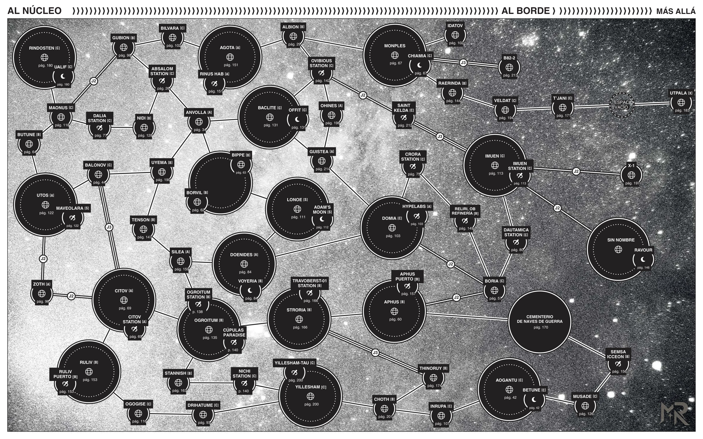

<p align="center">
  
</p>

<p align="center">
  <a href="https://github.com/ManuRomera"></a>
  <a href="https://github.com/ManuRomera/mr-wages-of-sin/releases/latest"></a>
  
  <a href="https://github.com/ManuRomera/mr-wages-of-sin/releases"></a>
  
  
  <a href="LICENSE"></a>
</p>

<h3 align="center">Las 100 Órdenes de Busca, los 10 Cazarrecompensas rivales, las 3 naves nuevas y el módulo carcelario completo <em>«La ODC: Baclite»</em> de <strong>Wages of Sin</strong> en español para Foundry VTT.</h3>

> [!IMPORTANT]
> Este módulo está diseñado para el sistema [**MoSh – Unofficial Mothership**](https://foundryvtt.com/packages/mosh) (`0.6.1+`) y se integra de forma nativa con [**MR- Mothership en español**](https://github.com/ManuRomera/mr-mothership-es) (traducción, modo oscuro y accesibilidad compartidos), [**MR- Kit del Desguazador**](https://github.com/ManuRomera/mr-kit-desguazador) (ficha de nave y combate naval para las 3 naves incluidas) y [**MR- Dirección**](https://github.com/ManuRomera/mr-direccion) (lecturas, relojes y figuras de cuerpo entero a escala).

<p align="center">
  <a href="https://github.com/ManuRomera/mr-wages-of-sin/releases/latest/download/module.zip"><strong>⬇️ Descargar última versión</strong></a>
  ·
  <a href="#-instalar"><strong>⚡ Instalar</strong></a>
  ·
  <a href="#-qué-trae-el-módulo"><strong>📦 Contenido</strong></a>
  ·
  <a href="#-cómo-empezar"><strong>🎯 Cómo empezar</strong></a>
</p>

---

## 🎯 Así se ve

<p align="center">
  
  
</p>

<p align="center">
  
  
</p>

---

## 📦 Qué trae el módulo

Al activar **MR- Wages of Sin** en un mundo vacío, el módulo importa automáticamente las 16 escenas, las naves, los cazarrecompensas, los manuales y las macros, y abre la guía de inicio. Todo el contenido está además organizado en 8 compendios en español:

| Compendio | Tipo | Documentos | Qué incluye |
|---|---|---:|---|
| **Las 100 Órdenes de Busca (`ordenes`)** | JournalEntry | 5 (100 págs.) | Las **100 órdenes de busca oficiales (`#01` a `#100`)** con su retrato, código de 6 dígitos, Nivel de Busca (`BL 1–10`), cartel público para jugadores y sección secreta del Guardián. |
| **Objetivos, Cazadores y ODC (`objetivos`)** | Actor | 127 | Los **100 objetivos de busca** con su retrato, token redondo y estadísticas; los **10 Cazarrecompensas rivales** con figura de cuerpo entero y tácticas `1d5`; **jefes, guardias y presos de la ODC**; y la **Fauna de Offit**. |
| **Naves (`naves`)** | Actor | 3 | **MPT «Bus»** (*Valecore MPT-SC J2C-II*), **Hunter-Seeker** (*Gauss CR-Medusa J1C-II*) y **Veil of Night** (*Utpala Shipyards Magnum Opus J3C-VI*) con sus planos de cubierta a doble página, compatibles con **MR- Kit del Desguazador**. |
| **Armas de Prisión y Equipos (`equipo`)** | Item | 26 | Armas improvisadas y de tala de la ODC (pincho, anillos, pilas en calcetín, látigo de cuchillas, hachuela, motosierra, bisturí), equipo de captura (pistola sedante, porra eléctrica, grilletes, TaskMaster, féretro de estasis) y paquetes de equipo inicial. |
| **Manual y Guía de la ODC (`manual`)** | JournalEntry | 8 | El manual completo en español: cómo dirigir sesiones sueltas y campañas, reglas de rastreo y entrega, fuerzas del orden, delitos de jugadores, juicios, los 10 cazarrecompensas y la guía íntegra de **La ODC: Baclite** y el **Infierno Verde**. |
| **Tablas y Generadores (`tablas`)** | RollTable | 10 | Tabla `1d100` de las 100 órdenes, generadores de objetivo, delito y complicación, pistas de rastreo, modelos policiales, cazarrecompensas rivales, rumores de presos, encuentros en el Infierno Verde y fauna de Offit. |
| **Macros (`macros`)** | Macro | 6 | Accesos directos para abrir la Terminal, generar una orden al azar, rastrear una presa, evaluar un delito del grupo, intentar un soborno en la ODC o simular un día en el Infierno Verde. |
| **La ODC: Baclite y Sector (`aventura-baclite`)** | Adventure | 1 | Aventura lista para importar con **16 escenas** (portada, Mapa de Salto, estaciones, prisión ODC en versión mesa y versión Guardián, plano de celda, mapa del Infierno Verde en versión mesa y Guardián y cubiertas de naves) y paquete para **MR- Dirección**. |

---

## 🖥️ Terminal interactiva de Recompensas y ODC

Pulsa el botón <i class="fa-solid fa-crosshairs"></i> en los controles de escena de Tokens (o usa la macro incluida) para abrir la **Terminal de Recompensas y ODC Baclite** (`ConMemoria`):

1. **Las 100 Órdenes:** Filtra al instante por nombre, estación (*Absalom, Anvollapolis, Balonov, HypeLabs Domia, Utpala, Offit ODC…*), etiqueta o Nivel de Busca (`BL 1–10`). Pulsa **«Mostrar Cartel (Sin spoilers)»** para enviar al chat la ficha pública del objetivo sin revelar los secretos del Guardián.
2. **Generador y Rastreo:** Crea contratos nuevos en un clic, tira fuentes de investigación o aplica la regla de oro del libro: el **Oráculo BL (`1d10 ≤ BL`)**.
3. **Delitos, Juicios y Cazadores:** Comprueba si las pruebas dejadas vinculan a la tripulación con un delito (`1d10 ≤ nivelPrueba`), actualiza el `BL` del grupo, dicta sentencia judicial y despacha a cualquiera de los **10 Cazarrecompensas rivales** con su táctica `1d5`.
4. **La ODC: Baclite e Infierno Verde:** Resuelve intentos de **Soborno (`1d100 < Soborno`)** al personal de la prisión, lleva el registro de **Reputación** con las bandas (*23 Arms*, *Sindicato Stratemeyer*, *Sindicato de Presos*, *Funcionarios CO*) y simula las jornadas de fuga y forrajeo de bayas por la jungla de Offit.

---

## ⚡ Instalar

### Desde Foundry VTT (recomendado)

1. En Foundry, ve a **Add-on Modules → Install Module**.
2. En **Manifest URL**, pega:
   ```text
   https://github.com/ManuRomera/mr-wages-of-sin/releases/latest/download/module.json
   ```
3. Pulsa **Install**.

### Manual

Descarga [`module.zip`](https://github.com/ManuRomera/mr-wages-of-sin/releases/latest/download/module.zip) de la última versión y descomprímelo dentro de `Data/modules/mr-wages-of-sin/`.

---

## 🔧 Cómo está hecho

```bash
npm install
npm test                   # ejecuta los tests unitarios del núcleo puro (node --test)
python3 tools/extract_assets.py
python3 tools/build_foundry.py
npm run build              # compila _data/*.json -> packs/* y genera dist/module.zip
```

---

## 📜 Créditos y aviso

- **Obra original:** *Wages of Sin* (`MRPG-M6`), de Luke Gearing, Jarrett Crader, Sean McCoy et al. (© 2025 Tuesday Knight Games). **Mothership** es una marca de Tuesday Knight Games.
- **Diseño, programación, Terminal interactiva y adaptación a Foundry VTT:** Manu Romera (MR · Digital RPG Design).
- **Licencia:** MIT para el código del módulo. Consulta [`NOTICE.md`](NOTICE.md) y [`LICENSE`](LICENSE).

<p align="center">
  <sub>MR- · Manu Romera · <a href="https://github.com/ManuRomera">github.com/ManuRomera</a></sub>
</p>
